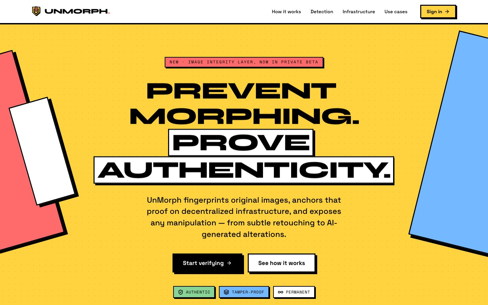
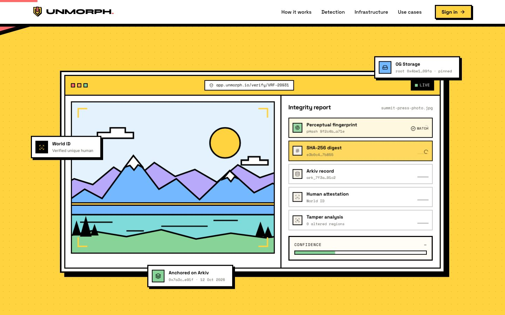
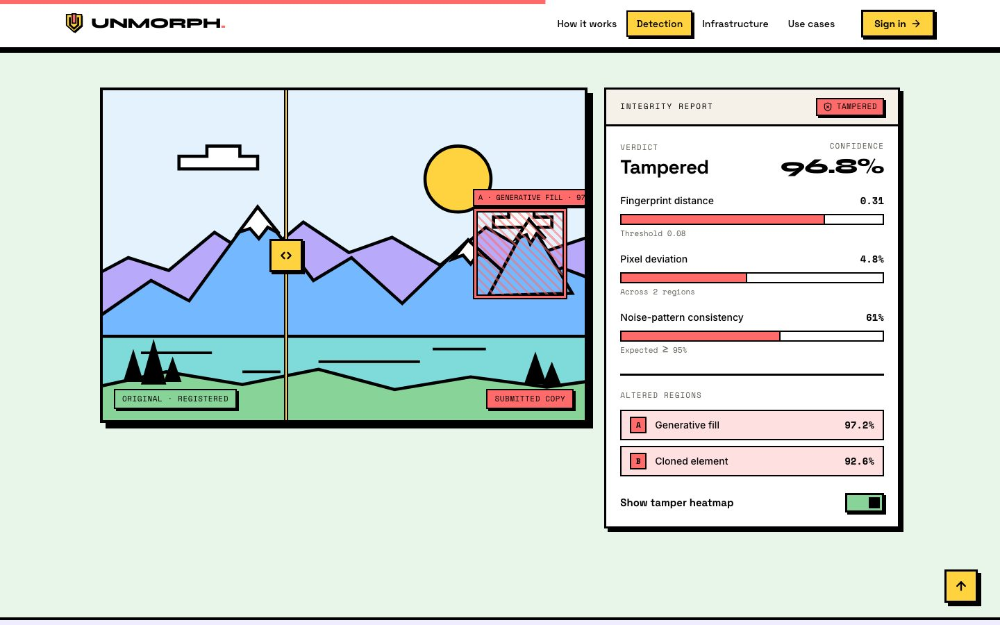
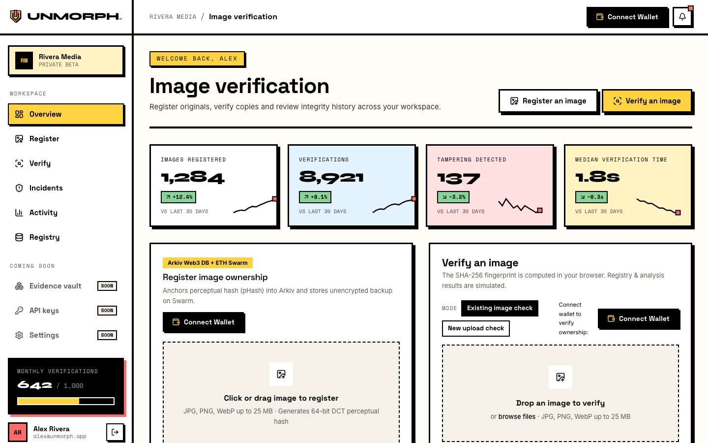
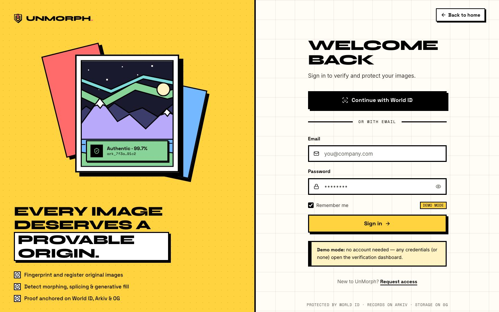
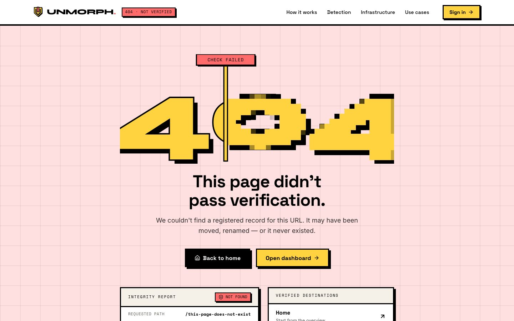
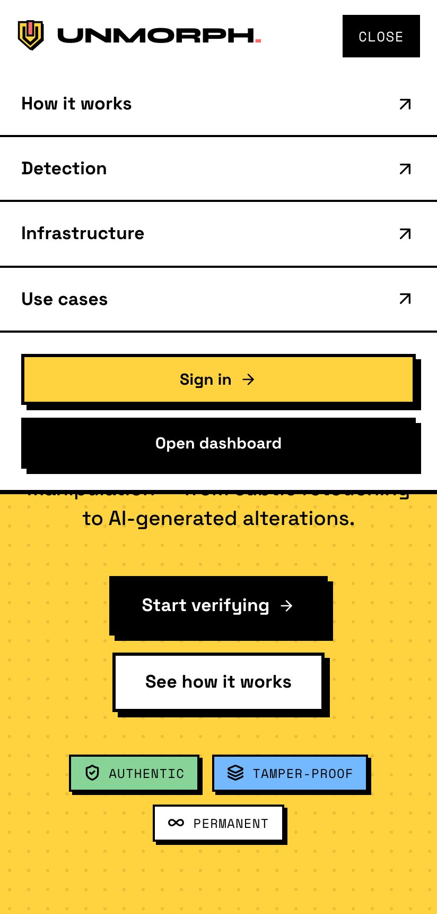
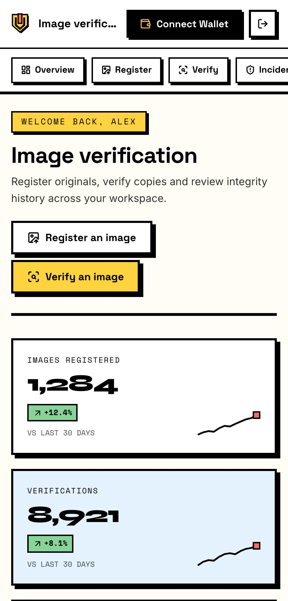

<div align="center">


# UnMorph

**The image integrity layer.**<br />
Prevent morphing. Prove authenticity.

<p>
  
  
  
  
  
  
</p>

<p>
  <a href="#overview">Overview</a> ·
  <a href="#screens">Screens</a> ·
  <a href="#getting-started">Getting started</a> ·
  <a href="#tech-stack">Tech stack</a> ·
  <a href="#project-structure">Structure</a> ·
  <a href="#design-system">Design system</a>
</p>



</div>

---

## Overview

Generative AI makes it trivial to alter a photograph — swap a face, edit evidence, morph an ID
portrait. **UnMorph** is a decentralized security layer that makes that manipulation detectable and
makes authenticity independently verifiable.

It combines cryptographic fingerprinting, AI tamper detection, proof of personhood and decentralized
infrastructure:

| Layer        | Role in UnMorph                                                                            |
| ------------ | ------------------------------------------------------------------------------------------ |
| **World ID** | Privacy-preserving proof that a registration comes from a unique human — no personal data. |
| **Arkiv**    | Wallet-owned, queryable records of fingerprints, ownership and verification history.       |
| **0G**       | Decentralized storage for originals and evidence, plus compute for AI tamper analysis.     |

### How it works

1. **Register** — fingerprint the original with a SHA-256 digest and a perceptual hash that survives
   resizing and recompression; optionally bind it to a World ID–verified human.
2. **Anchor** — write the fingerprint and metadata to an Arkiv record; store the image and evidence
   bundle on 0G.
3. **Verify** — check any copy against the registry. Tamper detection pinpoints morphing, splicing
   and generative fill down to the region, with an auditable confidence score.

Read the full vision in [`docs/project-overview.md`](docs/project-overview.md).

> [!NOTE]
> **This repository is currently a front-end prototype.** Sign-in is a demo (any credentials open the
> dashboard) and the dashboard runs on deterministic internal mock data. The SHA-256 fingerprint in the
> verifier is real — computed in the browser with Web Crypto — while the registry lookup, tamper
> analysis and attestation are simulated from that hash.

## Screens

<table>
  <tr>
    <td width="50%" valign="top">
      
      <p align="center"><sub><b>Landing</b> — yellow hero slab, hard-shadow verification console, black marquee band</sub></p>
    </td>
    <td width="50%" valign="top">
      
      <p align="center"><sub><b>Tamper detection</b> — draggable original-vs-copy comparison with heatmaps</sub></p>
    </td>
  </tr>
  <tr>
    <td width="50%" valign="top">
      
      <p align="center"><sub><b>Dashboard</b> — KPIs, live verifier, activity chart and registry</sub></p>
    </td>
    <td width="50%" valign="top">
      
      <p align="center"><sub><b>Sign in</b> — demo email & World ID flows into the dashboard</sub></p>
    </td>
  </tr>
  <tr>
    <td width="50%" valign="top">
      
      <p align="center"><sub><b>404</b> — "This page didn't pass verification", with a pixel-morphed 404</sub></p>
    </td>
    <td width="50%" valign="top" align="center">
      
      
      <p align="center"><sub><b>Mobile</b> — sticky bar with a Space Mono MENU drop-down; responsive dashboard</sub></p>
    </td>
  </tr>
</table>

### Highlights

- **Sticky neubrutalist nav** — white bar with a 4px rule, yellow active-section block, pink
  reading-progress strip and a Space Mono `MENU` drop-down on small screens.
- **Scroll-driven motion** — Lenis smooth scrolling with Motion parallax: a 3D console that flattens
  into place, a manifesto that inks in word by word, a sticky "how it works", pinned horizontal use
  cases and a rising footer wordmark.
- **Working verifier** — drag-and-drop or sample images run through a staged pipeline with a real
  in-browser SHA-256 and deterministic mock verdicts; results land in the registry table and open in
  a full integrity report.
- **Accessible by default** — reduced-motion support everywhere, keyboard-operable slider and chart,
  status never conveyed by colour alone, and a table view for every chart.

## Getting started

**Prerequisites:** [Bun](https://bun.sh) ≥ 1.4. This repo is **Bun-only** — `npm`, `pnpm` and
`yarn` installs are rejected by a pre-install guard.

```bash
git clone https://github.com/maitreya-ai/UnMorph.git
cd UnMorph

bun install                 # dependencies + Husky git hooks
bun run test:e2e:install    # one-time: Playwright's Chromium
bun run dev                 # → http://localhost:3000
```

### Scripts

| Command                 | Description                                                            |
| ----------------------- | ---------------------------------------------------------------------- |
| `bun run dev`           | Start the dev server (Turbopack)                                       |
| `bun run build`         | Production build                                                       |
| `bun run start`         | Serve the production build                                             |
| `bun run lint`          | ESLint (Next.js core-web-vitals + TypeScript rules)                    |
| `bun run typecheck`     | `tsc --noEmit`                                                         |
| `bun run format`        | Prettier with Tailwind class sorting                                   |
| `bun run test`          | Jest unit & component tests                                            |
| `bun run test:coverage` | Jest with V8 coverage                                                  |
| `bun run test:e2e`      | Playwright on desktop + Pixel 7 (builds & serves on `:3100` if needed) |
| `bun run test:e2e:ui`   | Playwright UI mode                                                     |

### Quality gates

| Hook           | Runs                                                                          |
| -------------- | ----------------------------------------------------------------------------- |
| **pre-commit** | lint-staged → ESLint `--fix`, Prettier, related Jest tests · then `typecheck` |
| **pre-push**   | Full Jest suite · Playwright end-to-end suite                                 |

## Tech stack

| Concern   | Choice                                                                                                                              |
| --------- | ----------------------------------------------------------------------------------------------------------------------------------- |
| Framework | [Next.js 16](https://nextjs.org) — App Router, Turbopack, Cache Components, Partial Prefetching                                     |
| Language  | TypeScript (strict)                                                                                                                 |
| Styling   | [Tailwind CSS v4](https://tailwindcss.com) — CSS-first tokens in `src/app/globals.css`                                              |
| Motion    | [Motion](https://motion.dev) for scroll-linked and layout animation · [Lenis](https://lenis.darkroom.engineering) for smooth scroll |
| Icons     | [Lucide](https://lucide.dev)                                                                                                        |
| Fonts     | Syne · Space Grotesk · Inter · Space Mono, self-hosted at build time via `next/font/google`                                         |
| Testing   | Jest + Testing Library · Playwright                                                                                                 |
| Tooling   | Bun · Husky · lint-staged · ESLint · Prettier                                                                                       |

## Project structure

```text
src/
├── app/
│   ├── (marketing)/          # landing page + layout (smooth scroll, nav, footer)
│   ├── sign-in/              # demo sign-in
│   ├── dashboard/            # dashboard shell + overview
│   ├── not-found.tsx         # branded 404
│   ├── fonts.ts              # next/font/local setup
│   └── globals.css           # design tokens, keyframes, utilities
├── components/
│   ├── nav/                  # sticky site nav + back-to-top
│   ├── landing/              # hero, manifesto, how-it-works, detection, bento, use cases, CTA, footer
│   ├── auth/                 # sign-in form + brand panel
│   ├── dashboard/            # KPIs, verifier, chart, table, drawer, sidebar
│   ├── not-found/            # 404 view
│   ├── motion/               # Reveal, RevealWords, Parallax primitives
│   └── visuals/              # procedural vector landscapes used as imagery
├── hooks/                    # pointer parallax, active section, media query, measure
├── lib/
│   ├── mock-data.ts          # deterministic internal mock data
│   ├── verification.ts       # SHA-256 + mock verdict engine
│   └── build-verification.ts # pipeline result → registry record
e2e/                          # Playwright specs
assets/                       # brand source (flat SVG logo mark)
docs/                         # product overview + README screenshots
```

### Routes

| Route           | What's there                              |
| --------------- | ----------------------------------------- |
| `/`             | Landing page                              |
| `/sign-in`      | Demo sign-in → `/dashboard`               |
| `/dashboard`    | Image verification dashboard on mock data |
| _anything else_ | Branded 404                               |

## Design system

**Neubrutalism**, copied token-for-token from the reference at
[neubrutalism.com](https://neubrutalism.com) — palette, border scale, shadow scale, type stack and
interaction states. Everything lives in [`src/app/globals.css`](src/app/globals.css).

| Token      | Hex       |                                                                                              |
| ---------- | --------- | -------------------------------------------------------------------------------------------- |
| Canvas     | `#FFFDF5` |  |
| Ink        | `#000000` |  |
| Yellow     | `#FFD23F` |  |
| Pink       | `#FF6B6B` |  |
| Blue       | `#74B9FF` |  |
| Green      | `#88D498` |  |
| Orange     | `#FFA552` |  |
| Lavender   | `#B8A9FA` |  |
| Warm stone | `#F5F0E8` |  |
| Code       | `#1A1A2E` |  |

Each accent also has a `-light` tint (e.g. `#FFF3C4`, `#FFE0E0`, `#E3F2FD`) used for full-bleed section bands.

- **Rules** — `border-radius: 0` everywhere; 2px / 3px / 4px solid black borders; hard offset shadows
  with zero blur (`3px`, `5px`, `8px`, `12px`); no gradients, blur or glass.
- **Interaction** — buttons lift `-2px,-2px` into a bigger shadow on hover and press `+3px,+3px` flat
  on click (`nb-press`, `nb-press-sm`); focus is a 3px blue outline.
- **Typography** — Syne 800 for display only (hero, wordmark, stats), Space Grotesk 700 for every
  heading (sentence case), Inter 400 for body, Space Mono for labels, badges and every hash/ID.
- **Signature pieces** — mono `.section-label` chips (`nb-label`), warm-stone card header strips,
  midnight code blocks (`nb-code`), hatched tamper markers (`nb-tamper`), a black marquee band,
  pastel section bands split by 4px rules, and a yellow back-to-top square.
- **Verdict colours** — authentic green `#88D498`, unregistered orange `#FFA552`, tampered pink
  `#FF6B6B`; always paired with an icon and a label, never colour alone.

## Implementation notes

- **Cache Components & `<Activity>`** — Next.js keeps recently visited routes mounted but hidden.
  Transient UI (menus, drawers, loading states, in-flight verifications) resets in `useLayoutEffect`
  cleanups, and dashboard section ids are prefixed (`dash-*`) so they never collide with the hidden
  landing page.
- **Reduced motion** — honoured via `MotionConfig reducedMotion="user"`, Lenis
  `respectReducedMotion`, and a global CSS fallback.
- **Deterministic mocks** — all mock data is seeded and uses a fixed clock, so server and client
  renders always match.

## Roadmap

- [ ] Real authentication with World ID
- [ ] Arkiv integration for registry records and integrity history
- [ ] 0G storage for originals/evidence and 0G compute for tamper models
- [ ] Public verification API

## Credits

Syne, Space Grotesk, Inter and Space Mono are licensed under the SIL Open Font License 1.1.
Design language after [neubrutalism.com](https://neubrutalism.com).

<div align="center">
<sub>Built with care for a world where every image can prove where it came from.</sub>
</div>
